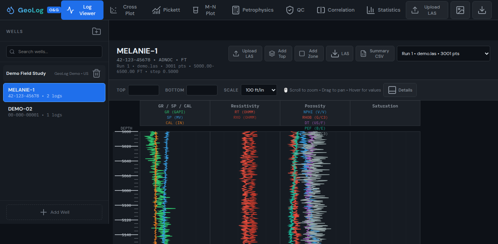

# GeoLog — Advanced Well Log Interpretation Platform

Comprehensive, production-style subsurface interpretation platform for oil & gas workflows. GeoLog combines high-performance log visualization, petrophysical computation, correlation, zonation, quality control, and export/reporting in a FastAPI + SQLite + Canvas-based stack.




---

## Features

GeoLog currently includes **35+ analysis views/panels** and **100+ API capabilities** spanning ingestion, interpretation, QC, analytics, collaboration, and export.

### 1) Data Ingest
- LAS **2.0** parser with robust field-file handling (LAS 3.0 headers are read for `DLM`/`WRAP`, but 3.0 multi-section files are treated as 2.0)
- Supports whitespace and **comma-delimited** LAS variants
- Vendor mnemonic normalization/fallback (e.g., DEPTH/DEPT/MD, ILD/RESD/RT families)
- Never drops a `~C` definition: `~A` columns are positional, so duplicate canonical names are kept under their vendor mnemonic instead of shifting every later curve
- Reports `~C`/`~A` column-count disagreements as parse warnings instead of truncating silently
- Multi-run per well upload and management
- **Bulk import wizard** for multi-file ingestion with progress feedback
- CSV upload utilities for selected workflows (e.g., tops/RFT)

### 2) Multi-Track Log Viewer
- High-performance **Canvas-rendered** viewer
- Standard **4-track layout** (GR/SP/CAL, resistivity, porosity, saturation)
- Adaptive depth ruler and synchronized hover readout
- Overlay support: formation tops, zones, DST intervals, RFT points, annotations
- Interactive navigation: **scroll zoom**, **drag pan**, jump-to-top/bottom
- Optional details/advanced controls and fullscreen workflow mode

### 3) Petrophysics
- Archie-based quicklook petrophysics
- **Dual-Water** saturation model endpoint/workflow
- VCL models:
  - **Larionov**
  - **Clavier**
  - **Steiber**
- Cutoff-based net pay evaluation and zone summaries
- Batch petrophysics workflows (sync + async)
- **Multi-mineral solver workflows** via calculator/derived-curve tooling
- **NMR T2** vendor-bin interpretation and raw CPMG NNLS inversion (`docs/NMR.md`)
- **Core/SCAL** plugs, RCA/SCAL, capillary pressure, FZI flow units, Winland R35/FZI rock typing, five saturation-height models, XLSX import and staged depth matching (`docs/CORE_SCAL.md`)
- **SEG-Y seismic** upload, section viewer, manual picks, correlation auto-tracking and coherence-based fault candidates for IBM/IEEE float lines (`docs/SEISMIC.md`)
- **Production economics** with probabilistic decline (P90/P50/P10), NPV, payout and a simple fiscal model (`docs/PRODUCTION_ECONOMICS.md`)
- **Source-rock screening** with Passey ΔlogR and Schmoker TOC, kerogen volume, stored `TOC`/`VKER` curves, analysis metadata/history and a combined rock-type/TOC PDF (`docs/SOURCE_ROCK.md`)
- **Geomechanics** screening stress/pore-pressure/mud-window model, provenance labels and breakout calibration (`docs/GEOMECHANICS.md`)
- **Borehole images** conditioned image assets and manual dip picking (`docs/IMAGE_LOGS.md`)
- **WITSML/OSDU** 1.4.1.1 and Wellbore DDMS well/log adapters (`docs/INTEROP.md`)
- **PostgreSQL** opt-in dual-dialect deployment with copy/verify/rollback tools (`docs/POSTGRES.md`)
- **Petrophysics workbench** Core/SCAL, geomechanics and image-log panels (`docs/PETROPHYSICS_UI.md`)
- **Token lifecycle** rotating refresh tokens and jti revocation (`docs/AUTH_REFRESH.md`)

### 4) Well Correlation
- Interactive **2-well correlation panel**
- Manual marker tie picking with marker table/summary
- **AutoTie** (cross-correlation based shift recommendation)
- Shift/stretch controls with profile persistence
- Top-snap assistance and overlayed top matching cues

### 5) Cross-Section
- Project-level **well-to-well structural cross-section**
- Curve rendering/fill between wells
- Formation-top correlation lines across wells
- Stratigraphic normalization to reference formations
- Cross-section interaction helpers and export helpers

### 6) Formation Tops
- Full CRUD for formation tops
- Project/well-level import-export support
- **Petrel-compatible tops export**
- Auto-pick tops workflow with review and save
- Top overlays available in viewer and correlation/cross-section contexts

### 7) Zonation
- Manual zone editing + persistence
- **Auto-zone from tops**
- Zone statistics endpoints and panels
- Zonation report export (zone gross/net and averaged properties)
- Zone editing operations (split/merge/reorder) with undo/redo-aware workflow

### 8) QC & Data Quality
- Per-curve QC metrics (missing %, outlier %, mean/std)
- Reliability tagging (HIGH / MEDIUM / LOW)
- QC recommendations and anomaly notes
- **QC Auto-fix** API to patch common quality issues
- Small-sample confidence handling and warnings

### 9) Crossplots & Interpretation Plots
- **RHOB–NPHI crossplot**
- **Pickett plot**
- **M–N plot**
- **Hingle plot**
- **Buckles plot**
- **Probability plot**
- Crossplot matrix at project level

### 10) Sensitivity & Uncertainty
- Parameter sweep workflows for petrophysical uncertainty
- Scenario comparison summaries
- **Tornado chart** output for spread/impact visualization

### 11) Electrofacies
- Electrofacies clustering and facies assignment
- Supports **k-means / GMM-style** clustering workflows
- Facies distribution summaries and visualization
- Async electrofacies job execution with job monitor

### 12) DST / RFT
- DST interval entry/listing and viewer overlay
- RFT point entry/listing + CSV upload
- Pressure-depth crossplot canvas
- Pressure gradient computation endpoint

### 13) Curve Editing
- Interactive click-based curve editing workflows
- Curve overrides and filtering endpoints
- Edit persistence with history-aware interactions
- **Undo/redo** support for interactive interpretation actions

### 14) Core Calibration
- Core-log calibration workflows
- Depth matching utilities
- Porosity/permeability transform endpoints and derived properties

### 15) Export & Reporting
- Export **LAS** from selected/active data context
- Export **CSV** (summary tables, zonation, tops, data table)
- Export **PDF** report endpoint
- Export viewer **PNG**
- Export bulk JSON package for project handoff
- **Petrel-compatible tops** export

### 16) User Management & Governance
- Role-based access control (**viewer / interpreter / admin**)
- Header-driven role enforcement on API operations
- Built-in **audit trail** endpoint and UI panel
- User CRUD endpoints

### 17) Performance & Scalability
- LTTB-based data **decimation** endpoint
- Viewport-based loading for large logs
- Debounced curve fetch and selective rendering
- FastAPI **GZip compression** middleware
- Async job queue pattern for heavy workflows

---

## Quick Start

### Method 1 — One-command local run (`run.sh`)
```bash
chmod +x run.sh
./run.sh
```
- Starts GeoLog at: `http://localhost:8000`
- Swagger: `http://localhost:8000/docs`

### Method 2 — Docker
```bash
docker compose up --build
```
Then open `http://localhost:8000`.

### Method 3 — Manual (Python)
```bash
python3 -m pip install -r requirements.txt
python3 -m uvicorn backend.main:app --host 0.0.0.0 --port 8000 --reload
```

---

## API Documentation

Interactive OpenAPI docs are available when server is running:
- Swagger UI: `http://localhost:8000/docs`
- ReDoc: `http://localhost:8000/redoc`

### Audit Signature Verification Contract (Compliance)

Export endpoint:
- `GET /api/audit-log/verify/export?sign=true&kid=<optional>`
- returns: `payload`, `signature`, `signature_alg`, `signature_kid`

Verify endpoints:
- `GET /api/audit-log/verify/signature` (query params: `payload`, `signature`, `kid`)
- `POST /api/audit-log/verify/signature` (JSON body: `payload`, `signature`, `kid`) — requires `interpreter` role

Verifier response fields:
- `ok`: boolean
- `reason`: human-readable detail
- `reason_code`: stable enum for machine integration
- `signature_alg`: currently `hmac-sha256`
- `signature_kid`: key-id used during verification

`reason_code` values:
- `SIGNATURE_VALID`
- `SIGNATURE_MISMATCH`
- `UNKNOWN_KID`
- `INVALID_KEYRING_JSON`
- `ACTIVE_KID_MISSING`
- `KEY_NOT_CONFIGURED`
- `KEY_RESOLUTION_ERROR` (fallback)

Signing key env config:
- `AUDIT_EXPORT_HMAC_KEYS_JSON='{"k1":"secret1","k2":"secret2"}'`
- `AUDIT_EXPORT_HMAC_ACTIVE_KID='k2'`
- legacy fallback: `AUDIT_EXPORT_HMAC_KEY`

End-to-end `curl` examples:

1) Export signed payload
```bash
curl -s "http://localhost:8000/api/audit-log/verify/export?sign=true&kid=k1" \
  -H "X-User-Role: viewer" > /tmp/audit_export.json
```

2) Verify via GET endpoint
```bash
PAYLOAD=$(jq -c '.payload' /tmp/audit_export.json)
SIGNATURE=$(jq -r '.signature' /tmp/audit_export.json)
KID=$(jq -r '.signature_kid' /tmp/audit_export.json)

curl -G -s "http://localhost:8000/api/audit-log/verify/signature" \
  -H "X-User-Role: viewer" \
  --data-urlencode "payload=${PAYLOAD}" \
  --data-urlencode "signature=${SIGNATURE}" \
  --data-urlencode "kid=${KID}" | jq .
```

3) Verify via POST endpoint (M2M, interpreter role)
```bash
jq '{payload: .payload, signature: .signature, kid: .signature_kid}' /tmp/audit_export.json > /tmp/audit_verify_req.json

curl -s -X POST "http://localhost:8000/api/audit-log/verify/signature" \
  -H "Content-Type: application/json" \
  -H "X-User-Role: interpreter" \
  --data-binary @/tmp/audit_verify_req.json | jq .
```

---

## Keyboard Shortcuts

| Shortcut | Action |
|---|---|
| `1` | Switch to Log Viewer |
| `2` | Switch to Cross Plot |
| `3` | Switch to Pickett Plot |
| `4` | Switch to Petrophysics |
| `5` | Switch to QC |
| `6` | Switch to Statistics |
| `7` | Switch to Correlation |
| `8` | Switch to Sensitivity |
| `9` | Switch to Facies |
| `Arrow Up` | Pan depth window upward |
| `Arrow Down` | Pan depth window downward |
| `+` / `=` | Zoom in |
| `-` | Zoom out |
| `Home` | Jump to top boundary |
| `End` | Jump to bottom boundary |
| `Esc` | Close modals/help/palette/nav groups |
| `?` | Open keyboard shortcut help |
| `Ctrl/Cmd + K` | Open command palette |
| `Ctrl/Cmd + Z` | Undo |
| `Ctrl/Cmd + Shift + Z` | Redo |
| `Ctrl/Cmd + Y` | Redo |
| `Ctrl/Cmd + S` | Save annotations |
| `Ctrl/Cmd + E` | Export LAS |
| `Ctrl/Cmd + U` | Upload LAS |
| `F` | Toggle fullscreen viewer |
| `L` | Toggle lithology track |
| `D` | Toggle details panels |
| `A` | Toggle advanced controls |
| `R` | Refresh render |

---

## Project Structure

```text
geolog-app/
├── backend/
│   ├── main.py            app assembly, middleware, health
│   ├── database.py        engine and session factory
│   ├── models.py          SQLAlchemy models
│   ├── schema.py          Alembic runner + drift verification
│   ├── migrations/        Alembic revisions
│   ├── security.py        auth modes and role resolution
│   ├── deps.py            SafeJSONResponse, role dependencies
│   ├── validation.py      request-body validation helpers
│   ├── audit.py           audit chain + evidence signing
│   ├── observability.py   request counters
│   ├── jobs.py            in-process background job registry
│   ├── well_state.py      locks, snapshots, template signatures
│   ├── curve_corrections.py   density-porosity + bad-hole QC
│   ├── curve_plausibility.py  stored-curve sanity checks
│   ├── las_parser.py      LAS 2.0 parser
│   ├── dlis_lis_parser.py DLIS/LIS parsers
│   ├── version.py         single-source version
│   ├── seed.py            demo data seeding
│   ├── demo.las
│   ├── requirements.txt
│   └── routers/           wells, log_runs, projects, audit, ops, qc,
│                          correlation, zonation, units, templates,
│                          reports, users
├── frontend/
│   ├── index.html
│   ├── assets/
│   ├── css/
│   │   ├── style.css
│   │   └── sprint26.css
│   └── js/
│       ├── app.js
│       └── log-renderer.js
├── data/
│   ├── public_sample.las
│   ├── hawkins_01.las
│   └── public/
├── tests/
│   └── test_parser.py
├── test-data/
├── test_data/
├── Dockerfile
├── docker-compose.yml
├── run.py
├── run.sh
├── requirements.txt
├── LICENSE
└── README.md
```

---

## Testing

### Parser + API smoke tests script
```bash
python -m pytest tests/test_parser.py -q
```

### Browser e2e smoke (views + role-gates)
```bash
npm ci
npx playwright install --with-deps chromium
node scripts/e2e_panel_smoke.js
node scripts/e2e_role_gate_smoke.js
```

### With pytest
```bash
python -m pytest -q tests/test_parser.py
```

### Phase 2 critical-path coverage gate (target >=80%)
```bash
bash scripts/phase2_critical_coverage_gate.sh
```

Gate scope (Phase 2 reliability/governance critical path):
- `backend/security.py`
- `backend/routers/reports.py`

Phase 2 regression dataset evidence:
- Manifest: `test_data/regression_datasets_phase2.json`
- Validation test: `tests/test_phase2_regression_datasets.py`
- Requirement: at least 3 realistic LAS datasets, parseable with expected minimum depth points and curves.

### Phase 3a security + backup gates
```bash
bash scripts/backup_restore_drill.sh backend/data/geolog.db
```

Optional signing env for backup drill evidence:
- `BACKUP_DRILL_SIGNING_KEY`
- `BACKUP_DRILL_SIGNING_KID` (default: `backup-drill`)
- `BACKUP_DRILL_RETENTION_DAYS` (default: `30`)

Security CI workflow:
- `.github/workflows/security-gates.yml`
- Checks:
  - `bandit -q -r backend -lll` (high severity gate)
  - `pip-audit -r requirements.txt`
  - backup/restore drill smoke
  - API attestation gate for `artifacts/backup-drill` (`scripts/security_evidence_attest.py`)
  - signed manifest gate (`/api/ops/security-evidence/manifest?sign=true`)
  - hardcoded secret token regex gate

Ops status endpoints:
- `/api/ops/security-posture-status`
- `/api/ops/security-evidence-status`
- `/api/ops/security-evidence/manifest`
- `/api/ops/security-evidence/manifest/verify-signature` (GET viewer+, POST interpreter+)
- `/api/ops/security-evidence/attest` (POST, interpreter+)
- `/api/ops/security-evidence/attest/latest` (GET, viewer+)
- `/api/ops/security-evidence/freshness` (GET, viewer+)
- `/api/ops/security-evidence/gate` (GET, viewer+, supports `max_age_seconds` + `min_retention_days` + `required_checks` + `strict_required_checks`; includes `gate_reason_code` + `gate_failed_count` + `gate_passed_count` + `gate_total_count` + `gate_pass_ratio` + `gate_fail_ratio` + `gate_consistency_ok` + `gate_consistency_reason` + `strict_required_checks` + `defaulted_checks` + `requested_checks` + `ignored_checks` + `duplicate_checks` + `evaluated_checks` + `failed_checks` for automation)
- `/api/ops/security-evidence/gate/enforce` (GET, viewer+, returns 503 when gate fails, supports `max_age_seconds` + `min_retention_days` + `required_checks` + `strict_required_checks`)
- `/api/ops/security-evidence/gate/assert` (POST, interpreter+, returns 503 when gate fails, supports `max_age_seconds` + `min_retention_days` + `required_checks` + `strict_required_checks`)
- `503` gate failure response is schema-based (`OpsSecurityEvidenceGateErrorResponse`) and includes `gate_reason_code` + `gate_failed_count` + `gate_passed_count` + `gate_total_count` + `gate_pass_ratio` + `gate_fail_ratio` + `gate_consistency_ok` + `gate_consistency_reason` + `strict_required_checks` + `defaulted_checks` + `requested_checks` + `ignored_checks` + `duplicate_checks` + `evaluated_checks` + `failed_checks`
- `/api/ops/security-evidence/gate/check` (POST, interpreter+, always 200 with gate payload, supports `max_age_seconds` + `min_retention_days` + `required_checks` + `strict_required_checks`)
- Contracts registry version for gate family is now `1.14`
- `/api/ops/evidence-status?probe=true`

Security governance docs:
- `docs/BRANCH_PROTECTION_CHECKLIST.md`
- `docs/SECURITY_EVIDENCE_TEMPLATE.md`

Phase 3b performance/SLO gate:
- `.github/workflows/perf-slo-gates.yml`
- Script: `scripts/slo_load_gate.py`
- Validates measured latency/error-rate and `/api/ops/slo-status` checks under concurrent load.

Configuration reference:

| Variable | Default | Purpose |
|---|---|---|
| `GEOLOG_ENV` | `dev` | `dev`/`local`/`test`/`ci` allow the trusted-header auth shim; anything else is treated as a real deployment |
| `AUTH_MODE` | `header` in dev, `jwt` elsewhere | `header` trusts the `X-User-Role` request header. `jwt` requires a verified bearer token. `header` is refused when `GEOLOG_ENV` is non-dev |
| `AUTH_JWT_SECRET` | — | HMAC secret for `AUTH_MODE=jwt` |
| `AUTH_JWT_ISSUER` / `AUTH_JWT_AUDIENCE` | — | Optional JWT claim checks (OIDC-ready) |
| `AUTH_JWT_ALGORITHMS` | `HS256` | Comma-separated allowed algorithms |
| `GEOLOG_CORS_ORIGINS` | unset | Comma-separated allowed origins. Unset disables CORS entirely; the bundled frontend is same-origin and needs none |
| `GEOLOG_DB_PATH` | `backend/geolog.db` | SQLite file location |
| `GEOLOG_ARTIFACT_DIR` | `backend/artifacts` | File backend state, image/core assets and security evidence |
| `GEOLOG_STATE_BACKEND` | `file` | `database` moves rate limits, metrics, jobs, locks and snapshots into the primary database; use PostgreSQL for multi-host |
| `GEOLOG_JOB_STALE_SECONDS` | `900` | Reclaim a running job whose worker stopped heartbeating |
| `GEOLOG_RUN_MIGRATIONS_ON_STARTUP` | `true` in dev/test, `false` elsewhere | Production must run `alembic upgrade head` as a deploy step |
| `GEOLOG_FAIL_ON_SCHEMA_MISMATCH` | `true` outside dev | Refuse to start when the live schema differs from the models |
| `GEOLOG_ENFORCE_PROJECT_ACL` | `true` | Project membership enforcement; see `docs/PROJECT_ACL.md` |
| `GEOLOG_AUTH_IP_LIMIT` / `GEOLOG_AUTH_IP_WINDOW_SECONDS` | `30` / `300` | Login attempts per source IP |
| `GEOLOG_AUTH_FAILURE_LIMIT` / `GEOLOG_AUTH_LOCKOUT_SECONDS` | `5` / `900` | Per-account failures before lockout and lockout duration |
| `GEOLOG_MAX_UPLOAD_BYTES` | `268435456` (256 MiB) | Per-file upload cap; streamed, never read unbounded |
| `GEOLOG_MAX_BODY_BYTES` | `67108864` (64 MiB) | Non-multipart request body cap |
| `GEOLOG_PBKDF2_ITERATIONS` | `240000` | Local user-secret hash cost |
| `GEOLOG_TRUST_PROXY` | `false` | Honour `X-Forwarded-For` for rate limiting; enable only behind a trusted proxy |
| `GEOLOG_ENABLE_DEMO_SEED` | `false` | Seed demo wells on first startup |
| `GEOLOG_ENFORCE_SECRETS_SOURCE` | `true` | Require `GEOLOG_SECRETS_SOURCE` in non-dev |
| `GEOLOG_SECRETS_SOURCE` | — | Required when `GEOLOG_ENV` is non-dev |
| `GEOLOG_ENABLE_DOCS` | `true` in dev/test, `false` elsewhere | Expose `/docs`, `/redoc` and `/openapi.json`; leave off in production unless the docs host is protected |
| `GEOLOG_ERROR_WEBHOOK_URL` | unset | POST redacted 5xx exception payloads to an operator endpoint |
| `GEOLOG_ERROR_WEBHOOK_INCLUDE_TRACE` | `false` | Include a truncated traceback in webhook payloads |
| `GEOLOG_OTEL_ENABLED` | `false` | Enable OTLP/HTTP tracing when the optional observability packages are installed |
| `GEOLOG_OTEL_ENDPOINT` | `http://localhost:4318/v1/traces` | OTLP/HTTP trace endpoint |
| `GEOLOG_OTEL_SERVICE_NAME` | `geolog` | `service.name` resource attribute |
| `GEOLOG_OTEL_SAMPLE_RATIO` | `1.0` | Trace sampler ratio, 0.0–1.0 |
| `GEOLOG_OTEL_HEADERS` | unset | JSON object of exporter headers, for example auth |
| `GEOLOG_OTEL_EXCLUDED_URLS` | health/metrics | Comma-separated paths excluded from instrumentation |
| `AUDIT_EXPORT_HMAC_KEYS_JSON` / `AUDIT_EXPORT_HMAC_ACTIVE_KID` | — | Audit/evidence signing key rotation |
| `AUDIT_EXPORT_HMAC_KEY` | — | Legacy single signing key (`kid='legacy'`) |

Header auth takes the caller's role from a request header, so anyone who can reach
the port can be an admin. It is a development convenience only.

### Schema migrations

The schema is owned by Alembic. In dev/test the app runs `upgrade head` at
startup. In production it **does not migrate**: run the migration once as a
deploy step, then start every worker with the same revision. The app verifies
the live schema and refuses to start if a table or column is missing.

```bash
GEOLOG_ENV=prod python -m alembic upgrade head
GEOLOG_ENV=prod python -m uvicorn backend.main:app --workers 2
```

```bash
python -m alembic upgrade head          # apply migrations
python -m alembic check                 # fail if a model changed without a migration
python -m alembic revision --autogenerate -m "add X"   # new migration
python -m alembic downgrade -1          # roll back one
```

`alembic check` is a CI gate. If you change a model without adding a migration,
the build fails with the exact missing operation rather than passing and then
breaking someone else's database.

Databases created before Alembic was introduced have every table but no
`alembic_version` row. Those are stamped at the baseline instead of being handed
the baseline `CREATE TABLE` statements, which would fail. See
`backend/schema.py`.

Note for contributors: `create_all()` is gone. Adding a field to `models.py` is
not enough — `create_all()` only ever created missing *tables*, never missing
*columns*, so such a change reached a fresh database and silently not an existing
one. Add a migration.

Notes:
- Parser tests run without server.
- API tests in `test_parser.py` require GeoLog running at `http://localhost:8000`.

---

## License

MIT License — see [LICENSE](LICENSE). Contribution and security guidance:
[CONTRIBUTING.md](CONTRIBUTING.md) and [SECURITY.md](SECURITY.md). Release steps
are in [docs/RELEASE.md](docs/RELEASE.md).

---

## Sponsor

If this project helps you, support ongoing development:

[](https://saweria.co/rinopatrick)
[](https://ko-fi.com/rinopatrick)

## Data semantics

Log data responses carry a `semantics` block and are corrected on read. See
[`docs/DATA_SEMANTICS.md`](docs/DATA_SEMANTICS.md) for the alias/unit/depth
control-point rules, API endpoints and response shape.

## Production-readiness status

Current state: **release candidate for a single-team, single-host deployment**.
It is not yet a multi-tenant SaaS: the API is still `0.x` and file-backed state
is single-host.

Version: see [`backend/version.py`](backend/version.py) (single source of truth)
and [CHANGELOG.md](CHANGELOG.md). While the major version is `0`, the API is not
stable and the schema may change between releases. Responses carry
`X-API-Version: v0` so clients can pin behavior. `/api/v1` is available as a
stable alias and reports `X-API-Version: v1`; see
[`docs/API_VERSIONING.md`](docs/API_VERSIONING.md).

Completed hardening:
- JWT refresh/rotation, jti revocation, JWKS/RS256 and issuer/audience checks.
- PBKDF2 hashing for locally managed user secrets; plaintext rows upgrade on
  first login.
- Login IP rate limit + per-account lockout, upload/body size caps, and a real
  backup/restore drill covering the database and artifact directory.
- Project and per-well membership ACL, enabled by default; see
  [`docs/PROJECT_ACL.md`](docs/PROJECT_ACL.md).
- Pinned, self-hosted Lucide; strict script CSP, delegated actions and escaping
  fixes for generated HTML.
- Durable background-job registry with crash recovery.

Remaining before a multi-tenant/SLA deployment:
1. Reduce the remaining core `frontend/js/app.js` and renderer modules further;
   the split currently covers UI, API, actions, reports, data, petrophysics and
   correlation.
2. Raise coverage on the petrophysics compute modules and add more real-world
   LAS/DLIS fixtures.
3. For more than one host, use PostgreSQL with
   `GEOLOG_STATE_BACKEND=database` and a shared volume/object store for binary
   assets and security evidence. See
   [`docs/PRODUCTION_HARDENING.md`](docs/PRODUCTION_HARDENING.md).

Module layout:
```
backend/
├── main.py            app assembly, middleware, small legacy routes, WebSocket
├── deps.py            SafeJSONResponse, role dependencies
├── security.py        header/JWT auth, token issuance, JWKS/public-key verification
├── schema.py          Alembic runner + drift verification
├── audit.py           audit chain + evidence signing
├── observability.py   per-worker request counters + DB-backed aggregation
├── jobs.py            durable file/DB job registry + handler dispatch
├── state_backend.py   database backend for rate limits, metrics, jobs and well state
├── tracing.py         optional OTLP/HTTP tracing
├── error_reporting.py optional redacted error webhook
├── acl.py             project/well membership enforcement
├── passwords.py       PBKDF2 secret hashing
├── ratelimit.py       file/DB login throttling
├── uploads.py         bounded upload reader + body-size middleware
├── filelock.py        cross-process lock for the file state backend
├── curve_corrections.py  density-porosity + bad-hole QC
├── curve_plausibility.py stored-curve sanity checks
├── migrations/        Alembic revisions
└── routers/           users, log_runs, projects, audit, ops, qc,
                       correlation, zonation, units, templates, reports,
                       wells (core CRUD/snapshots), wells_uploads,
                       wells_data, wells_exports, wells_compute,
                       wells_analytics
```

DLIS/LIS parsing uses `dlisio` on Python 3.10+. On Python 3.9 the package is
skipped and uploads fall back to the heuristic scan with a warning.

### Real DLIS/LIS files (optional)
```bash
GEOLOG_DLIS_SAMPLE=/path/file.dlis \
GEOLOG_LIS_SAMPLE=/path/file.lis \
python -m pytest tests/test_dlis_lis_real_samples.py -q
```
Samples are not committed; see `tests/test_dlis_lis_real_samples.py` for the
NumPy/dlisio constraint.
